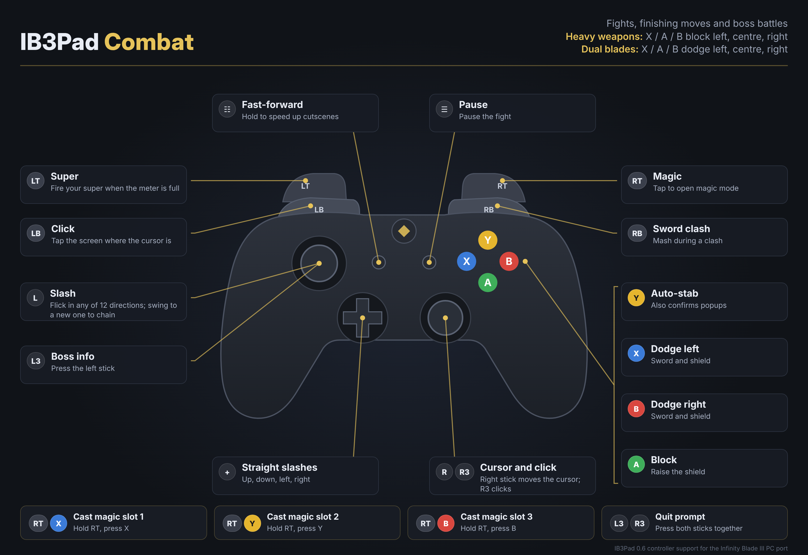
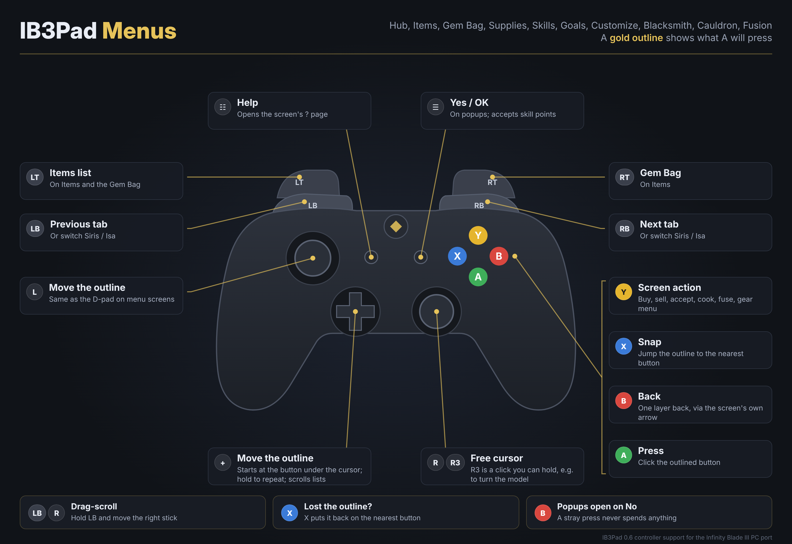
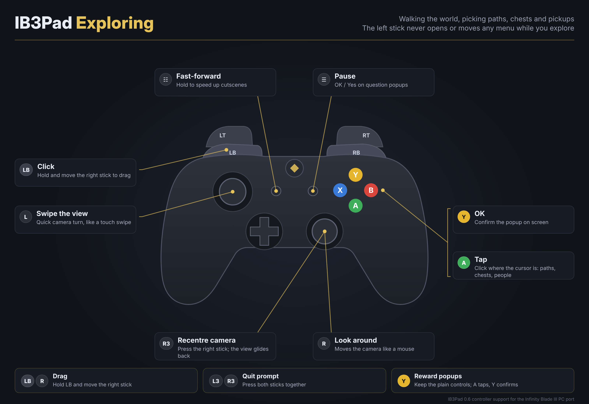

# IB3Pad

**Full controller support for the unofficial Infinity Blade III PC port (v1.0).**

Fights, exploring and every main menu screen, played entirely on an Xbox-style controller. One small DLL, no game files changed, no keybind setup.



## Features

- **Instant slashes.** Flick the left stick in any of 12 directions and the game's own slash command fires immediately. Swing from one direction to another to chain slashes.
- **Every combat action on a button.** Dodge, block, auto-stab, super, magic mode, the three magic slots, sword clash and boss info.
- **Real controller menus.** A gold outline shows what A will press. The D-pad moves between buttons, B goes back one layer, X snaps the outline to the nearest button. Items, Gem Bag, Supplies, Skills, Goals, Customize, Blacksmith, Cauldron, Fusion Chamber, progress lists and popups each get controls that fit them.
- **Exploring stays natural.** The right stick looks around like a mouse, the left stick swipes the view, and R3 swings the camera back to centre.
- **Keybind proof.** Buttons call the game's own command functions directly. No keyboard keys, no key bindings, so nothing you change in the launcher can break the controller.
- **Leaves no trace.** The only setting it touches (camera inversion) is applied for the session and put back byte for byte when the game closes, however it closes.

## Controls

The four control sheets cover everything. Every button can be remapped in `ib3pad.ini`.

| Sheet | What it covers |
|---|---|
| [Combat](docs/controls/1-combat.png) | Fights, finishing moves, boss battles, magic |
| [Exploring](docs/controls/2-exploring.png) | Walking the world, paths, chests, camera |
| [Menus](docs/controls/3-menus.png) | How every menu screen works with the controller |
| [Menu screens](docs/controls/4-menu-screens.png) | What changes on Items, Gem Bag, Skills, Blacksmith, Cauldron and the rest |

<p align="center"> </p>

## Install

1. Download `IB3Pad-0.6.0-beta7.1.zip` from [Releases](../../releases/latest).
2. Copy the `Binaries` folder from the zip into your game folder (the one that already holds `Binaries`, `Engine` and `SwordGame`). Two files land next to `IB3.exe`: `xinput1_3.dll` and `ib3pad.ini`. Nothing is overwritten.
3. Start the game from the launcher as usual.

**Requirements:** the Infinity Blade III PC port v1.0 on 64-bit Windows, and an XInput controller. Xbox pads work as they are. PlayStation and Switch pads work through Steam Input, DS4Windows or similar, set to emulate an Xbox 360 controller.

### Linux, Steam Deck and Proton

Wine and Proton prefer their own XInput, so tell them to load IB3Pad's copy. In Steam, set the shortcut's launch options to:

```
WINEDLLOVERRIDES="xinput1_3=n,b" %command%
```

In Lutris, add `xinput1_3` with the value `n,b` under Runner options, DLL overrides.

## Uninstall

Close the game, then delete `xinput1_3.dll`, `ib3pad.ini`, `ib3pad.state` and `ib3pad.log` from `Binaries\Win64`. That is the whole mod.

## How it works

IB3Pad is a proxy `xinput1_3.dll`. The game loads it from its own folder instead of the system copy, and IB3Pad forwards the real XInput calls to Windows. The port never actually polls the controller, so IB3Pad runs its own input thread.

- **Knowing where you are.** IB3Pad reads the engine's object and name tables (Unreal Engine 3) from the game's memory, read only, to see the HUD mode (fight, exploring, cinematic) and the stack of open menu screens. That is how the left stick knows when to slash and when to swipe, and which controls each screen gets.
- **Menus from the game's own data.** Button positions, list rows, inventory slots, gem sockets and which slots are filled are all read from the game's menu objects, so the outline lands exactly on what the game drew.
- **Commands, not keys.** Each action is resolved to the game's own UnrealScript command (for example `SwordPC.SlashLeft`, `SwordPC.ButtonDodgeLeft`, `SwordHudMain.ActivateMagicMode`) and called through the engine's `ProcessEvent` on the game thread. Calls are held back while a level is loading or tearing down.
- **The outline** is a click-through overlay window owned by the game window. It never takes focus.

IB3Pad contains no game code or assets. It changes no game file and no save.

## Configuration

Everything lives in `Binaries\Win64\ib3pad.ini`, with a comment on every setting. Buttons are mapped by game action name (`DodgeLeft`, `Block`, `Super`, `Magic`, `ScrollUp` and so on), and up to three can be joined with `+`. Useful switches:

- `[Camera] InvertX / InvertY` for camera inversion.
- `[General] ConfineCursor` to keep the cursor inside the game window while it has focus.
- `[Focus] Outline` and `OutlineColor` for the menu outline.
- `[Slash] FlickThreshold` and `RollAngle` to tune slash feel.

## Troubleshooting

- **Nothing happens.** After launching, `ib3pad.log` should appear next to `IB3.exe`. If it does not, the DLL was not loaded (on Proton, check the DLL override above).
- **The log says no controller.** The pad is not visible as XInput. Use Steam Input or DS4Windows to emulate an Xbox 360 controller.
- **Inputs fire twice.** Make sure `PassThroughToGame=0`.
- **Cursor stuck in the window.** That is intended while the game has focus; alt-tab releases it. Set `ConfineCursor=0` to turn it off.
- **Antivirus warning.** Input DLLs are sometimes flagged because they move the mouse and start a small cleanup helper (Windows' own rundll32). The full source is here, so you can read it or build it yourself.

When reporting a bug, open an issue and attach `ib3pad.log`. Setting `DebugInput=1` in `ib3pad.ini` makes the log far more useful.

## Building from source

Install the MinGW-w64 cross compiler (Debian or Ubuntu: `apt install gcc-mingw-w64-x86-64`; Windows: MSYS2 MinGW64) and run:

```
cd src
./build.sh
```

The result is `src/xinput1_3.dll`.

## Credits

Made by [LORDINFINITY12](https://github.com/LORDINFINITY12). The reverse engineering and much of the code were done with the help of AI tools (Claude by Anthropic). Every build was directed, play tested on real hardware and approved by the author before release.

## Disclaimer

IB3Pad is an unofficial fan project. It is not affiliated with or endorsed by Epic Games or Chair Entertainment. Infinity Blade is a trademark of its owners. Released under the MIT License.
